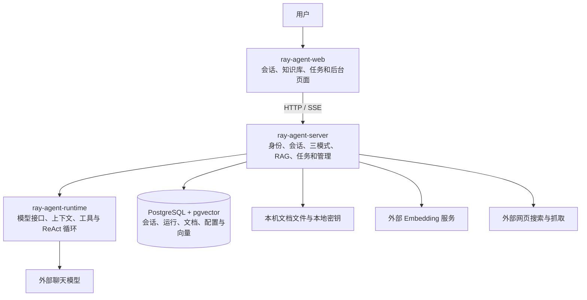
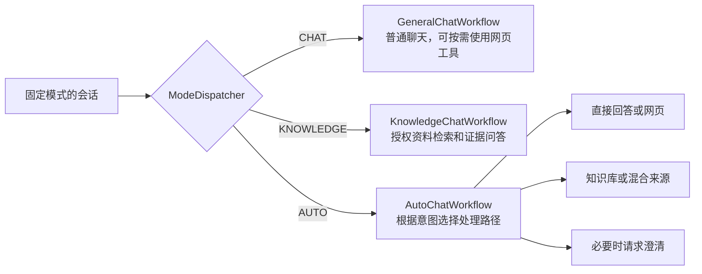

# 项目架构总览

项目分为前端 `ray-agent-web`、业务服务 `ray-agent-server` 和运行内核 `ray-agent-runtime`。后端作为单体服务运行，持久数据使用 PostgreSQL，文档向量使用 pgvector；模型、Embedding 和网页搜索是外部服务。

这张图表示职责和依赖方向；具体运行时调用路径见[主要业务链路](02-主要业务链路.md)。`runtime` 提供模型与工具运行能力，网页工具和 RAG 业务实现位于 `server`。

## 三种模式

- **CHAT**：不读取知识库；根据工具权限和模型决定，可能使用网页工具。
- **KNOWLEDGE**：从授权知识库取证据；证据不足时说明，不能自动转网页补答案。
- **AUTO**：可选择直接回答、网页、知识库、混合来源或澄清；混合答案区分资料与网页来源。

## 代码怎么找

| 位置 | 主要内容 |
| --- | --- |
| `ray-agent-web/src/pages` | 聊天、知识库和后台页面 |
| `ray-agent-web/src/api`、`stores` | 接口封装、流事件处理与前端会话状态 |
| `ray-agent-server/.../chat` | 聊天入口、上下文准备与模式分派 |
| `ray-agent-server/.../rag`、`knowledge` | 文档、切分、向量、检索、证据与引用 |
| `ray-agent-server/.../run`、`task` | 运行准入、排队、状态、接续和恢复 |
| `ray-agent-server/.../identity`、`admin` | 个人身份、配置、运行统计和后台操作 |
| `ray-agent-runtime/.../agent`、`tool`、`model`、`context` | Agent 循环、工具、模型契约和上下文处理 |

完整文件与职责见[类与前端文件分布](03-类与前端文件分布.md)。
