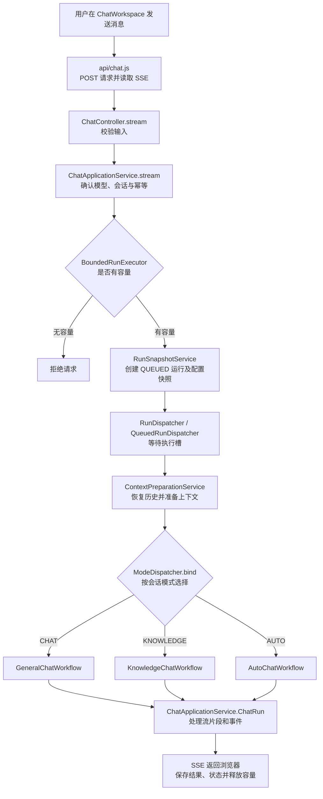
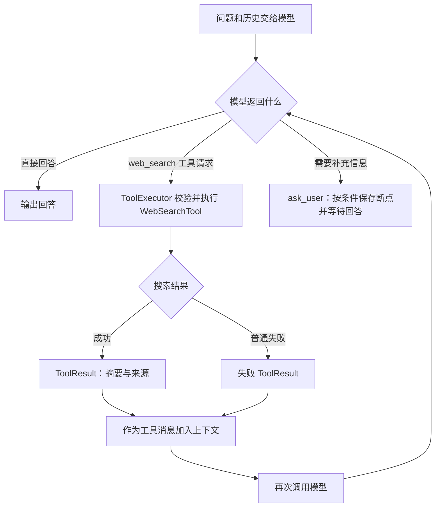
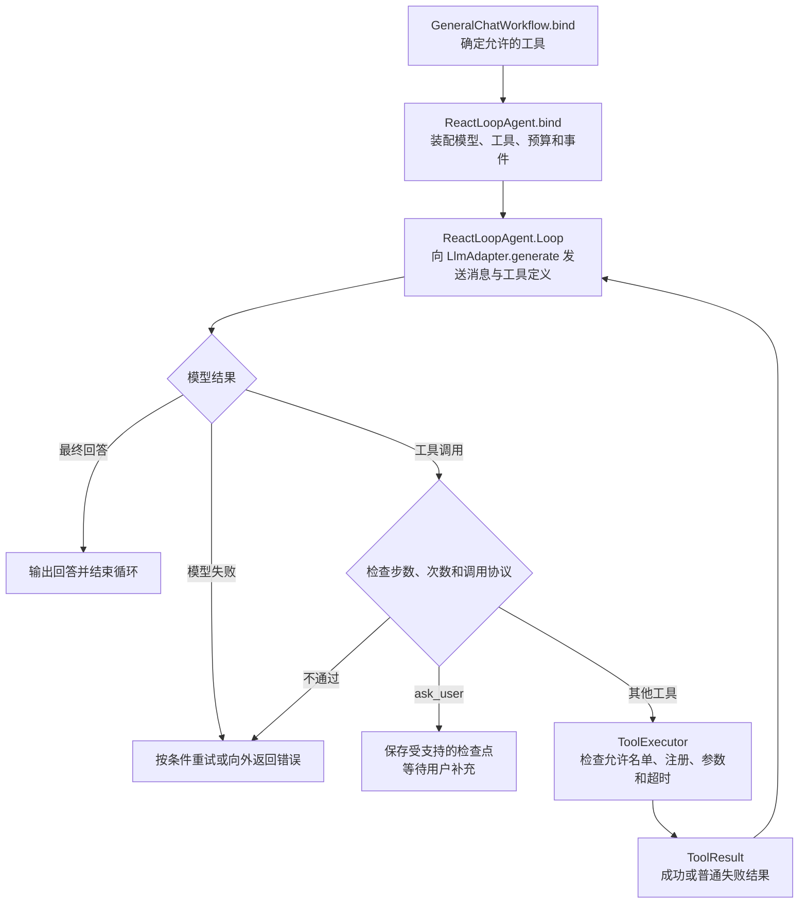
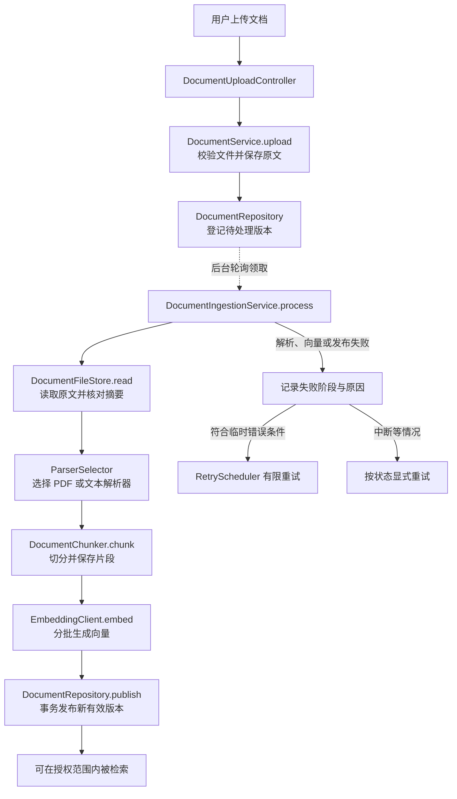
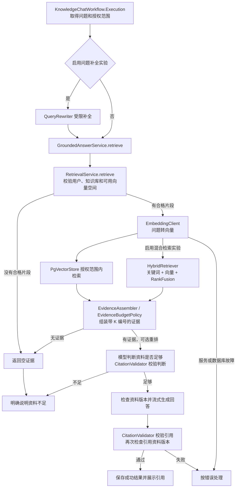
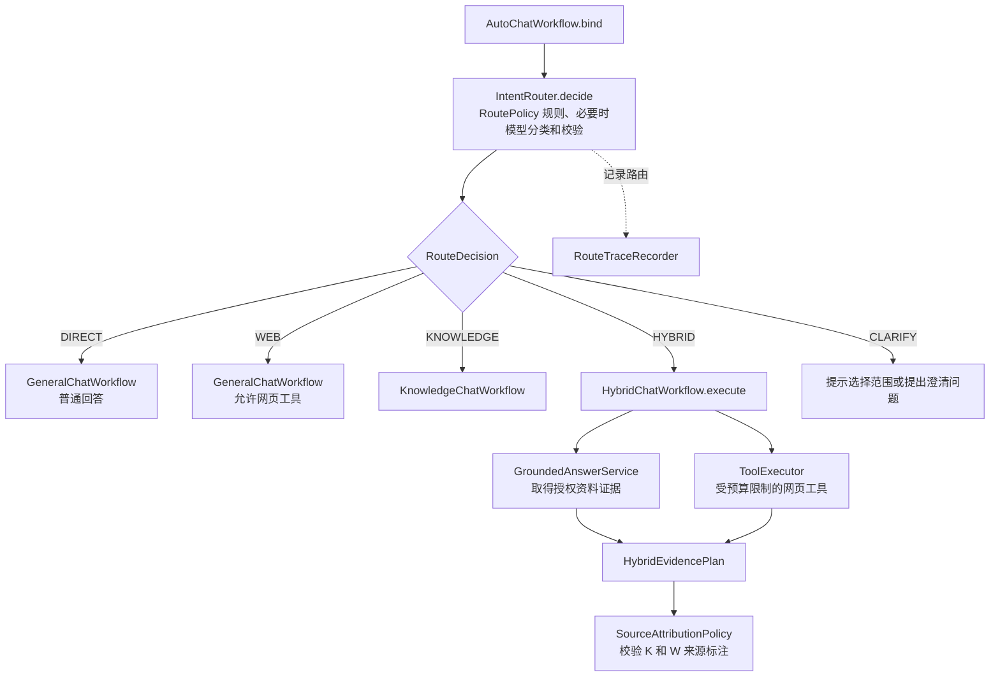
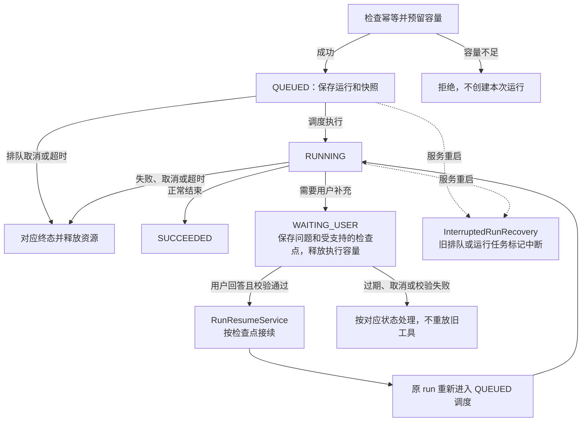
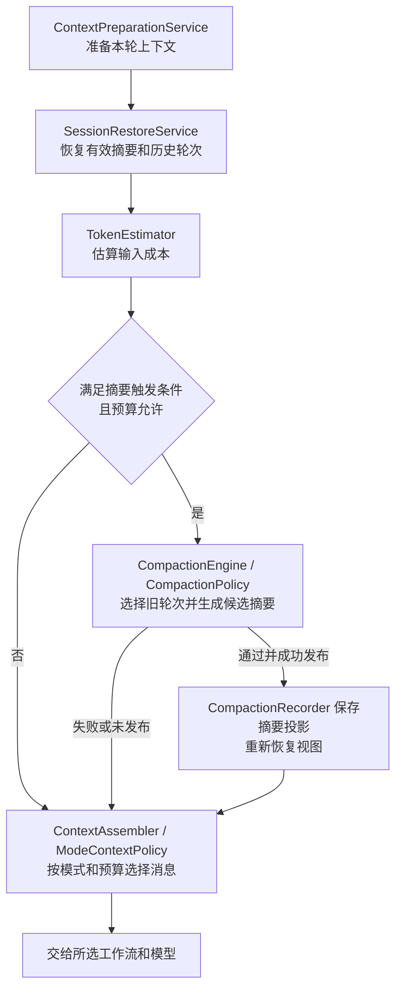
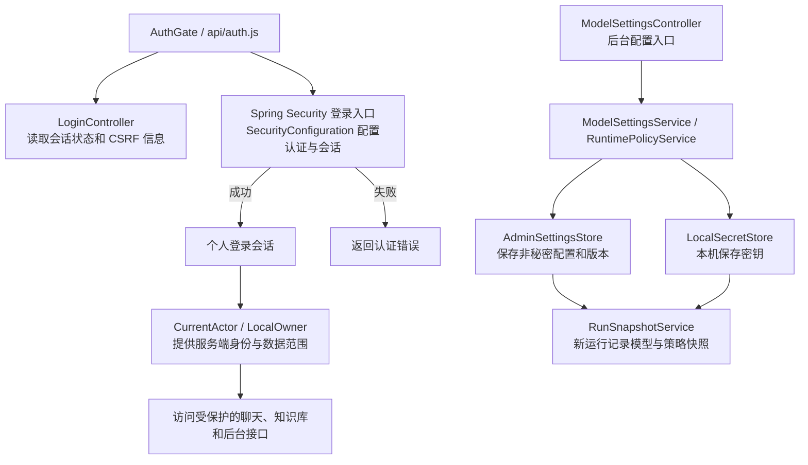
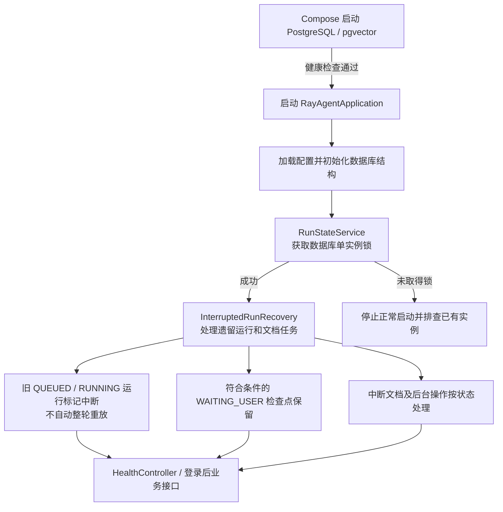

# 主要业务链路

本文整理自 [flows](../flows/) 的九组图及当前源码。类之间的箭头表示主要处理顺序；经过 Spring、异步调度、接口实现或流式订阅时，并不表示前一个类直接调用后一个类。数据类、错误处理和部分细节为便于阅读有所省略。

## 1. 一条消息从发送到返回

`sessionId` 标识会话，`runId` 标识一次运行，`clientRequestId` 用于重复请求识别。排队与执行、事件推送与持久化是不同阶段，不能把每个流式片段都理解为已作为完整答案保存。

**主要类**：`ChatController`、`ChatApplicationService`、`RequestIdempotencyService`、`BoundedRunExecutor`、`RunSnapshotService`、`QueuedRunDispatcher`、`ContextPreparationService`、`ModeDispatcher`、`ConversationRepository`。

**原图与补充**：[主链路](../flows/01-对话主链路/01-一次提问的链路.drawio) · [详细说明](../flows/01-对话主链路/01-说明.md) · [白话版](../flows/01-对话主链路/01-白话版.md)。原图部分表述以本文和当前源码为准：容量满会拒绝，不是永远排队。

### 示例：问“今天天气怎么样？”

假设在 CHAT 模式，历史中已经说明城市是合肥，且网页工具允许使用：

模型提出 `web_search` 只是请求，实际搜索要经过后端工具执行。本例假设搜索成功，并未构造实际天气数据；缺少城市、工具未启用或预算不足时可能走其他分支。参见[天气示例](../flows/01-对话主链路/04-今天天气怎么样-实际调用示例.drawio)和[失败分支图](../flows/01-对话主链路/05-天气提问-带失败分支的调用链.drawio)。

## 2. Agent 装配与 ReAct 工具循环

`ToolRegistry` 保存已注册工具，`ToolArgumentsParser` 校验参数，`ToolContext` 传递取消信号；工具失败通常作为结果交回模型，取消等情况另有处理。`RunBudget` 限制模型步数、工具次数及时间。

**原图**：[Agent 装配与 ReAct 循环](../flows/02-Agent装配与ReAct循环/01-Agent装配与ReAct循环-带分支的调用链.drawio)。

## 3. 文档上传与异步入库

上传成功只表示版本已接收，后台完成处理并发布后才可能被检索。新版本失败时，已有有效版本不会被当作新版本覆盖。`PgVectorStore` 主要用于后续向量查询；此处发布路径是 `DocumentRepository.publish`。

**原图**：[知识库入库](../flows/03-知识库入库/01-知识库入库-带分支的调用链.drawio)。

## 4. KNOWLEDGE：检索、证据与回答

`QueryRewriter`、混合检索和 `Reranker` 均属于默认关闭的实验；重排发生在证据组装之后、模型判断之前，条件不满足或失败时按代码跳过或回退。没有证据与 Embedding 故障是不同情况。引用校验帮助定位来源，不能保证回答逐句事实正确；流式输出时，最终校验失败前的文字可能已送到前端。

**原图**：[RAG 检索问答](../flows/04-知识库检索问答/01-RAG检索问答-带分支的调用链.drawio)。

## 5. AUTO 路由与混合来源

WEB 分支会检查网页工具是否实际尝试执行；HYBRID 按代码组织两类证据，而非多个 Agent 自由协商。缺少知识库范围、预算不足或工具失败时，按相应分支提示或报错。

**原图**：[AUTO 路由与混合来源](../flows/05-AUTO路由与混合来源/01-AUTO路由与混合来源-带分支的调用链.drawio)。

## 6. 运行生命周期、等待与恢复

关键类包括 `RunQueue`、`QueuedRunDispatcher`、`RunConcurrencyPolicy`、`SessionWriteLease`、`PendingQuestionStore`、`UserAnswerController`、`RunResumeService` 和 `InterruptedRunRecovery`。接续只覆盖实现支持且有效的检查点，不代表任意位置断点续传；连接中断的处理要结合入口和状态分析。

**原图**：[运行生命周期](../flows/06-运行生命周期/01-运行生命周期-带分支的调用链.drawio)。

## 7. 上下文与摘要

摘要是上下文投影，生成摘要不会自动删除原始消息；估算器基于字节与额外开销，并非供应商精确 tokenizer。取消和中断等异常需按实际代码传播，不能简单理解为全部静默回退。

**原图**：[上下文与摘要](../flows/07-上下文与摘要/01-上下文与摘要-带分支的调用链.drawio)。

## 8. 个人登录、身份和配置

当前范围为个人账号，不包含注册、共享和多角色。修改配置有版本及运行快照约束；Embedding 向量空间发生变化时需按保护规则处理并明确重建索引。登录、退出实际由 Spring Security 处理，`LoginController` 提供的是会话状态等信息。

**原图**：[身份与配置](../flows/08-身份与配置/01-身份与配置-带分支的调用链.drawio)。

## 9. 本机部署与启动恢复

此图是仓库本机 Compose 启动及恢复的学习示意。数据库持久卷保存的数据与健康检查范围，需要结合实际环境验证；本机启动成功不代表公网部署或容器访问外部模型已验证。

**原图**：[部署与启动恢复](../flows/09-部署与启动恢复/01-部署与启动恢复-带分支的调用链.drawio)。
